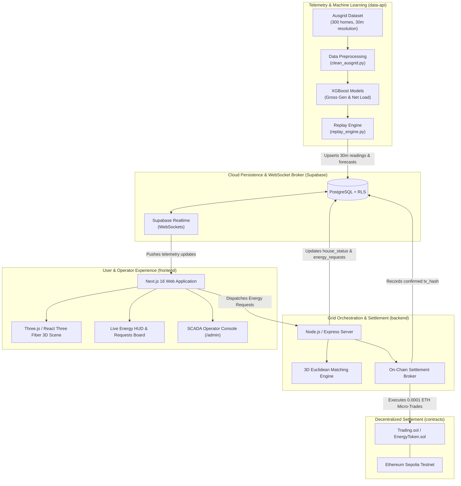

# Community Microgrid Peer-to-Peer (P2P) Energy Trading & Load Balancing

[](https://opensource.org/licenses/MIT)
[](https://nextjs.org/)
[](https://docs.pmnd.rs/react-three-fiber)
[](https://fastapi.tiangolo.com/)
[](https://xgboost.readthedocs.io/)
[](https://soliditylang.org/)
[](https://supabase.com/)
[](https://sepolia.etherscan.io/)

A full-stack decentralized energy ecosystem combining an interactive **3D Digital Twin**, **Machine Learning Demand & Solar Forecasting**, **Automated P2P Energy Trading**, and **Ethereum Smart Contract Settlement**. 

Trained and replayed against the real-world **Ausgrid Solar Home Electricity Dataset** (Sydney, Australia — 300 homes with 30-minute interval smart meter telemetry), this platform demonstrates autonomous microgrid islanding, nearest-prosumer Euclidean matching, and atomic micro-settlements during grid anomalies and outages.

---

## Table of Contents

1. [System Architecture](#system-architecture)
2. [Repository Directory Structure](#repository-directory-structure)
3. [Core Modules](#core-modules)
   - [3D Interactive Digital Twin (`/frontend`)](#1-3d-interactive-digital-twin-frontend)
   - [Machine Learning & Replay Engine (`/data-api`)](#2-machine-learning--replay-engine-data-api)
   - [Settlement & Orchestration Backend (`/backend`)](#3-settlement--orchestration-backend-backend)
   - [Smart Contracts (`/contracts`)](#4-smart-contracts-contracts)
   - [Operational Analytics (`/powerbi`)](#5-operational-analytics-powerbi)
4. [The 12 Live Microgrid Households](#the-12-live-microgrid-households)
5. [Machine Learning Pipeline](#machine-learning-pipeline)
6. [P2P Matching & Settlement Workflow](#p2p-matching--settlement-workflow)
7. [Installation & Setup Guide](#installation--setup-guide)
   - [Prerequisites](#prerequisites)
   - [Environment Variables](#environment-variables)
   - [Database Setup (Supabase)](#database-setup-supabase)
   - [Running the Services](#running-the-services)
8. [API Documentation](#api-documentation)
9. [Smart Contracts & Deployment](#smart-contracts--deployment)
10. [Operator SCADA & Admin Controls](#operator-scada--admin-controls)
11. [License & Acknowledgments](#license--acknowledgments)

---

## System Architecture

The microgrid platform operates as a distributed system with decoupled real-time streaming, predictive analytics, and blockchain settlement:



---

## Repository Directory Structure

```
community-microgrid-p2p-energy-trading/
├── .vscode/                               # Workspace configuration and editor settings
├── backend/                               # Grid orchestration and blockchain settlement service
│   ├── .env.example                       # Backend environment template
│   ├── index.js                           # Express server, P2P matching engine & Sepolia wallet broker
│   ├── package.json                       # Node dependencies (ethers, @supabase/supabase-js, cors, express)
│   └── package-lock.json
│
├── contracts/                             # Solidity smart contracts & Hardhat testing suite
│   ├── contracts/
│   │   ├── EnergyToken.sol                # ERC-20 token contract for tokenized microgrid energy (NRG)
│   │   └── Trading.sol                    # Atomic P2P settlement contract (direct ETH / token trades)
│   ├── test/
│   │   ├── EnergyToken.ts                 # Unit tests for ERC-20 minting, allowance, and transfers
│   │   └── Trading.ts                     # Unit tests for trade execution, fees, and state assertions
│   ├── hardhat.config.ts                  # Hardhat configuration (Sepolia network, Solidity 0.8.28)
│   ├── package.json                       # Web3 dev dependencies (hardhat, typechain, ethers)
│   └── .env.example                       # Sepolia RPC URL and private key variables
│
├── data-api/                              # Python Machine Learning and time-series replay service
│   ├── models/                            # Trained ML model weights and validation metrics
│   │   ├── metrics.json                   # Cross-validated RMSE and MAE performance scores
│   │   ├── xgboost_gg_kwh.joblib          # Trained XGBoost regressor for Gross Generation (PV)
│   │   └── xgboost_net_load_kwh.joblib    # Trained XGBoost regressor for Household Net Load
│   ├── src/
│   │   ├── clean_ausgrid.py               # Preprocessing pipeline for raw Ausgrid smart meter CSVs
│   │   ├── main.py                        # FastAPI endpoints for replay control and backup estimates
│   │   ├── predict.py                     # Feature engineering, lag variables, and inference module
│   │   ├── replay_engine.py               # Time-compressed 30-min simulation clock and Supabase sink
│   │   └── train_forecast.py              # Supervised XGBoost training pipeline
│   └── requirements.txt                   # Python packages (fastapi, uvicorn, xgboost, scikit-learn, pandas)
│
├── frontend/                              # Interactive 3D Digital Twin web application
│   ├── app/
│   │   ├── admin/
│   │   │   └── page.tsx                   # Password-protected Operator SCADA control deck
│   │   ├── api/                           # Secure Next.js server-side route handlers
│   │   │   └── admin/
│   │   │       ├── login/route.ts         # Constant-time HMAC password verification & session cookie
│   │   │       ├── logout/route.ts        # Session revocation endpoint
│   │   │       └── verify/route.ts        # Server-side auth verification endpoint
│   │   ├── components/
│   │   │   ├── EnergyRequestsBoard.tsx    # Live P2P requests board with Sepolia settlement buttons
│   │   │   ├── NeighborhoodMicrogrid3D.tsx# High-performance 3D scene (houses, voxels, conduits, beams)
│   │   │   ├── P2PTradingSimulator.tsx    # Interactive sandbox trading simulation
│   │   │   ├── ProjectExplanation.tsx     # Comprehensive architectural and ML explanation guide
│   │   │   ├── TopNav.tsx                 # Header navigation, live status pills, and theme toggle
│   │   │   └── VivaDefenseModal.tsx       # Embedded academic viva defense reference modal
│   │   ├── config/
│   │   │   └── houses.ts                  # Single source of truth for the 12 Ausgrid houses
│   │   ├── hooks/
│   │   │   └── useMicrogridData.ts        # Supabase Realtime synchronization and reactive state hook
│   │   ├── lib/
│   │   │   └── supabase.ts                # Public Supabase browser client
│   │   ├── globals.css                    # Tailwind CSS v4 design tokens and styling
│   │   ├── layout.tsx                     # Root HTML wrapper with fonts and metadata
│   │   └── page.tsx                       # Main landing page combining 3D scene and dashboard
│   ├── public/
│   │   ├── models/
│   │   │   └── house.glb                  # 3D suburban residential house asset
│   │   └── favicon.ico
│   ├── next.config.ts                     # Turbopack Next.js configuration
│   ├── package.json                       # React 19, Three.js, @react-three/fiber, Tailwind CSS
│   └── tsconfig.json                      # Strict TypeScript compilation options
│
├── powerbi/                               # Business Intelligence and analytical reports
│   └── microgrid-dashboard.pbix           # Power BI dashboard for load profile and settlement telemetry
│
├── supabase/                              # PostgreSQL migrations and Realtime configurations
│   └── migrations/
│       ├── 20261110173500_fix_table_permissions_and_rls.sql   # Public anon read & service role permissions
│       ├── 20261110180000_grid_events_and_house_status.sql    # Outage events, battery physics, initial states
│       ├── 20261110183000_energy_requests.sql                 # Request lifecycle & candidate tracking
│       └── 20261110185000_trades_settlement.sql               # Trade records and Etherscan verification
│
└── README.md                              # Complete system documentation (this file)
```

---

## Core Modules

### 1. 3D Interactive Digital Twin (`/frontend`)
Built with **Next.js 16 (Turbopack)**, **Three.js**, and **React Three Fiber (R3F)**:
- **Procedural Minecraft Voxel Suburb**: Renders a finite 52×38 voxel chunk slab with authentic cobblestone foundations, granite curbs, and perimeter forest barriers.
- **3D House Models**: Houses use `house.glb` clones with custom shader materials that dynamically dim to charcoal `#0f172a` during power outages or line disconnections.
- **Overhead Telemetry Badges**: Real-time Drei `<Html>` overlays displaying honest 30-min tick metrics (Generation, Usage, Battery %, and Net Surplus/Deficit).
- **Physical Feeder Conduits**: Glowing neon lines representing subterranean electric feeders. Severing a feeder produces a 3D conduit gap with an orange spark hazard beacon.
- **3D Energy Transfer Beams**: Settled peer-to-peer trades trigger an animated quadratic Bezier energy beam that arcs across the street between seller and buyer.
- **Interactive House Flashcard**: Displays verified Ausgrid ID, battery gauge, copyable MetaMask wallet address, and context-aware action triggers.

### 2. Machine Learning & Replay Engine (`/data-api`)
Built with **FastAPI**, **XGBoost**, and **Pandas**:
- **Dataset Replay**: Replays half-hourly historical data at user-selected simulation speeds (e.g., 1 real second = 1 30-minute interval).
- **Dual XGBoost Regressors**: 
  1. `xgboost_net_load_kwh`: Forecasts expected power consumption using lag variables ($t-1$, $t-2$, $t-48$), rolling means, and time features.
  2. `xgboost_gg_kwh`: Forecasts solar photovoltaic generation based on solar irradiance curves and diurnal hour patterns.
- **Backup Estimation Endpoint**: `/backup/estimate` aggregates current battery reserves and predicts net shortfalls across the microgrid over a 1 to 24 hour outage window.

### 3. Settlement & Orchestration Backend (`/backend`)
Built with **Node.js**, **Express**, and **Ethers.js v6**:
- **Nearest-Prosumer Matching Engine**: When an outage occurs or a consumer requests energy, the engine ranks candidate prosumers using **3D Euclidean distance** ($d = \sqrt{\Delta x^2 + \Delta z^2}$) and filters for available battery surplus ($> 0.2\text{ kWh}$).
- **Ping Lifecycle & Timeout**: Pings candidate prosumers with a 30-second acceptance timeout. If unanswered or denied, the engine cascades to the next nearest prosumer.
- **Auto-Accept Mode**: Operators can enable auto-acceptance with an authentic 2-second simulated network latency delay.
- **On-Chain Settlement**: Automatically dispatches 0.0001 ETH micro-settlements on the Ethereum Sepolia testnet upon trade acceptance.

### 4. Smart Contracts (`/contracts`)
Built with **Solidity 0.8.28** and **Hardhat**:
- **`Trading.sol`**: An atomic settlement smart contract enabling peer-to-peer energy trades. Emits `TradeExecuted(buyer, seller, kWh, totalPrice, timestamp)` events for immutable auditing.
- **`EnergyToken.sol`**: An ERC-20 token standard implementation representing kilowatt-hours (NRG) for tokenized utility microgrids.

### 5. Operational Analytics (`/powerbi`)
- Enterprise-grade Power BI dashboard connected directly to the Supabase PostgreSQL database for monitoring aggregate generation, peak demand shaving, self-consumption ratios, and financial savings.

---

## The 12 Live Microgrid Households

The microgrid layout models 12 residential households arranged in alternating **Consumer (C)** and **Prosumer (P)** positions along a central street, directly mapped to real IDs from the Ausgrid smart meter study:

| Index | 3D Label | Ausgrid ID | Role | Solar PV | Battery Storage | 3D Coords `[x, z]` | Showcase Wallet |
|:---:|:---:|:---:|:---:|:---:|:---:|:---:|:---:|
| 0 | **C1** | `18` | Consumer | No | None | `[-12.5, -4.5]` | **Real MetaMask (Buyer 1)** |
| 1 | **P1** | `282` | Prosumer | Yes | 6.0 kWh (4.5 kWh initial) | `[-7.5, -4.5]` | Deterministic Node Wallet |
| 2 | **C2** | `26` | Consumer | No | None | `[-2.5, -4.5]` | **Real MetaMask (Buyer 2)** |
| 3 | **P2** | `33` | Prosumer | Yes | 6.0 kWh (4.5 kWh initial) | `[2.5, -4.5]` | Deterministic Node Wallet |
| 4 | **C3** | `48` | Consumer | No | None | `[7.5, -4.5]` | Deterministic Node Wallet |
| 5 | **P3** | `212` | Prosumer | Yes | 6.0 kWh (4.5 kWh initial) | `[12.5, -4.5]` | **Real MetaMask (Seller 1)** |
| 6 | **P4** | `55` | Prosumer | Yes | 6.0 kWh (4.5 kWh initial) | `[-12.5, 4.5]` | Deterministic Node Wallet |
| 7 | **C4** | `90` | Consumer | No | None | `[-7.5, 4.5]` | Deterministic Node Wallet |
| 8 | **P5** | `244` | Prosumer | Yes | 6.0 kWh (4.5 kWh initial) | `[-2.5, 4.5]` | Deterministic Node Wallet |
| 9 | **C5** | `117` | Consumer | No | None | `[2.5, 4.5]` | Deterministic Node Wallet |
| 10 | **P6** | `112` | Prosumer | Yes | 6.0 kWh (4.5 kWh initial) | `[7.5, 4.5]` | Deterministic Node Wallet |
| 11 | **C6** | `141` | Consumer | No | None | `[12.5, 4.5]` | Initial Outage Benchmark |

---

## Machine Learning Pipeline

```
Raw Ausgrid CSVs (300 Homes, 3 Years)
               │
               ▼
   [ Data Cleaning & Normalization ] ────► Missing Value Interpolation & DST Alignment
               │
               ▼
   [ Feature Engineering ] ──────────────► Lags (t-1, t-2, t-48), Rolling 24h Stats, Hour/Day/Season Sine/Cosine
               │
               ▼
   [ Gradient Boosted Regression ] ──────► XGBoost (300 Estimators, max_depth=6, learning_rate=0.05)
               │
               ▼
   [ Model Artifacts ] ──────────────────► Joblib Serialized Weights (data-api/models/)
```

### Model Performance Metrics

Trained on 80% split and evaluated on unseen 20% holdout test dataset:

| Target Variable | Algorithm | Mean Absolute Error (MAE) | Root Mean Squared Error (RMSE) | Best Iteration |
|---|---|---|---|---|
| **Household Net Load (`net_load_kwh`)** | XGBoost Regressor | **0.1383 kWh** | **0.2612 kWh** | 299 |
| **Gross Solar Generation (`gg_kwh`)** | XGBoost Regressor | **0.0126 kWh** | **0.0418 kWh** | 244 |

---

## P2P Matching & Settlement Workflow

```
[Consumer C1 Enters Blackout / Line Cut]
                     │
                     ▼
       [Request Energy Backup Modal]
  (Calculates required kWh via ML estimate)
                     │
                     ▼
       [3D Euclidean Spatial Query]
  (Ranks eligible prosumers with battery > 0.2 kWh)
                     │
                     ▼
           [Ping Prosumer P1] ────────(30s Timeout / Denied)────► [Cascade to P4 (Next Nearest)]
                     │
         (Accepted or Auto-Accept 2s)
                     │
                     ▼
       [On-Chain Sepolia Micro-Settlement]
    - Transfers 0.0001 ETH
    - Deducts battery from Prosumer P1
    - Restores Consumer C1 out of blackout
    - Animates 3D Energy Beam across street
    - Stores confirmed tx_hash in Supabase trades
```

---

## Installation & Setup Guide

### Prerequisites
- **Node.js**: `v18.18.0` or higher (Node 20+ recommended)
- **Python**: `3.10` or higher
- **Git**
- **MetaMask Wallet** (for testing on-chain Ethereum Sepolia transactions)
- **Supabase Account** (free tier PostgreSQL database)

---

### Environment Variables

#### 1. Backend (`backend/.env`)
```bash
PORT=5001
SUPABASE_URL=https://your-project.supabase.co
SUPABASE_SERVICE_ROLE_KEY=your-supabase-service-role-key

# Ethereum Sepolia Blockchain (Optional for real testnet broadcast)
SEPOLIA_RPC_URL=https://eth-sepolia.g.alchemy.com/v2/your-api-key
OPERATOR_PRIVATE_KEY=your-sepolia-wallet-private-key
CONTRACT_ADDRESS=0x0000000000000000000000000000000000000000
```

#### 2. Frontend (`frontend/.env.local`)
```bash
NEXT_PUBLIC_SUPABASE_URL=https://your-project.supabase.co
NEXT_PUBLIC_SUPABASE_ANON_KEY=your-supabase-anon-key
NEXT_PUBLIC_BACKEND_URL=http://localhost:5001
ADMIN_PASSWORD=your-secure-admin-password
```

#### 3. Data API (`data-api/.env`)
```bash
SUPABASE_URL=https://your-project.supabase.co
SUPABASE_SERVICE_ROLE_KEY=your-supabase-service-role-key
DATA_PATH=./data/processed/ausgrid_clean_full.parquet
MODELS_DIR=./models
REPLAY_SPEED=1.0
```

---

### Database Setup (Supabase)

1. Open your project on the [Supabase Dashboard](https://supabase.com).
2. Navigate to the **SQL Editor**.
3. Run the migrations in order from the `supabase/migrations/` directory:
   - `20261110173500_fix_table_permissions_and_rls.sql`
   - `20261110180000_grid_events_and_house_status.sql`
   - `20261110183000_energy_requests.sql`
   - `20261110185000_trades_settlement.sql`
4. Verify that tables are created and added to the `supabase_realtime` publication.

---

### Running the Services

#### Step 1: Start the Machine Learning Replay Engine
```bash
cd data-api
python -m venv .venv

# On Windows:
.venv\Scripts\activate
# On macOS/Linux:
source .venv/bin/activate

pip install -r requirements.txt
uvicorn src.main:app --port 8000
```

#### Step 2: Start the Grid Orchestrator & Settlement Backend
```bash
cd backend
npm install
node index.js
```
*Backend runs on `http://localhost:5001`.*

#### Step 3: Start the 3D Digital Twin Frontend
```bash
cd frontend
npm install
npm run dev
```
*Frontend runs on `http://localhost:3000`.*

---

## API Documentation

### Backend Endpoints (`http://localhost:5001`)

| Method | Endpoint | Description |
|---|---|---|
| `GET` | `/api/status` | Returns microgrid outage status and persistent battery readings |
| `POST` | `/api/outage` | Triggers a society-wide power outage |
| `POST` | `/api/outage/restore` | Restores normal utility grid connection |
| `POST` | `/api/lines/cut` | Cuts feeder lines for specific household IDs |
| `POST` | `/api/lines/restore` | Restores isolated feeder lines |
| `GET` | `/api/requests` | Returns active P2P energy backup requests |
| `POST` | `/api/requests` | Initiates backup request & triggers 3D Euclidean matching |
| `POST` | `/api/requests/:id/respond`| Candidate prosumer accepts or denies incoming request |
| `POST` | `/api/requests/:id/settle` | Executes Sepolia micro-settlement for accepted trade |
| `GET` | `/api/requests/admin/auto-accept` | Returns current prosumer auto-accept configuration |
| `POST` | `/api/requests/admin/auto-accept` | Toggles prosumer auto-accept mode (`true`/`false`) |
| `GET` | `/api/backup/estimate` | Returns ML estimated backup duration & required kWh |

### Data API Endpoints (`http://localhost:8000`)

| Method | Endpoint | Description |
|---|---|---|
| `POST` | `/replay/start` | Begins time-compressed Ausgrid historical replay |
| `POST` | `/replay/stop` | Pauses active telemetry replay |
| `GET` | `/replay/status` | Current simulated timestamp and replay state |
| `POST` | `/replay/reset` | Resets simulation clock back to start of test dataset |
| `GET` | `/backup/estimate` | Computes aggregate surplus/deficit using ML predictions |

---

## Smart Contracts & Deployment

The contracts are built with Hardhat and configured for local and Sepolia networks.

```bash
cd contracts
npm install

# Compile Solidity contracts
npx hardhat compile

# Run Hardhat test suite
npx hardhat test

# Deploy to Sepolia testnet
npx hardhat run scripts/deploy.ts --network sepolia
```

### Trading Contract ABI Interface (`Trading.sol`)
```solidity
function executeTrade(
    address payable seller, 
    uint256 kwhAmount
) external payable;

event TradeExecuted(
    address indexed buyer,
    address indexed seller,
    uint256 kwhAmount,
    uint256 totalPriceWei,
    uint256 timestamp
);
```

---

## Operator SCADA & Admin Controls

Navigate to [`http://localhost:3000/admin`](http://localhost:3000/admin) to access the SCADA Operator Console:

- **Security Gate**: Protected by server-side constant-time HMAC buffer comparison (`crypto.timingSafeEqual`) issuing an `httpOnly`, `sameSite: strict` session cookie. Passwords and controls are completely omitted from the client bundle.
- **Default Operator Password**: `microgrid2026!`
- **Operator Features**:
  - **Society Outage Breaker**: Simulate full regional grid failure with a single switch.
  - **Prosumer Auto-Accept Engine**: Toggle between automated 2-second latency matching and manual household responses.
  - **Feeder Isolation**: Cut or restore individual distribution feeders or batch isolate the entire microgrid.
  - **Live Audit Stream**: Real-time event log of pings, acceptances, and on-chain settlements.

---

## License & Acknowledgments

- **Dataset**: Ausgrid Solar Home Electricity Data, Sydney, Australia.
- **License**: Released under the [MIT License](LICENSE).
- **Authors**: Developed for Advanced Agentic Microgrid Research and Decentralized Energy Demonstration.
